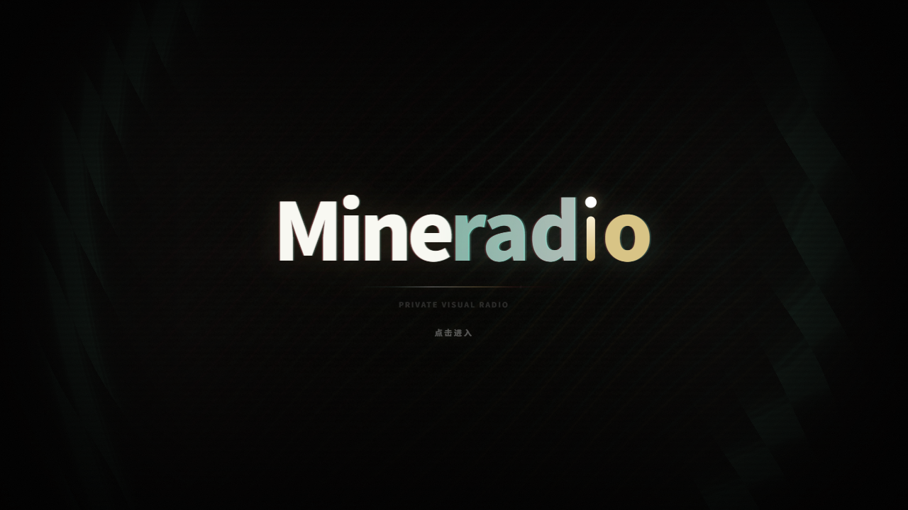

# Mineradio · 个人二创维护版

基于 [XxHuberrr 的 Mineradio 原项目](https://github.com/XxHuberrr/Mineradio-paused) 进行个人修改与维护。**原作作者和主要开发者为 XxHuberrr**，原作设计、版权、社区贡献与致谢均予以保留；本仓库由 [zhe8013-bot](https://github.com/zhe8013-bot) 维护个人二创版本。

原作者已宣布原项目长期停更。本仓库以原作 `2.2.0` 为基础，按个人使用需要进行修复，不承诺固定更新周期。原作者提交历史已保留，GitHub 贡献者统计由真实提交记录生成。



Mineradio 是一款 Windows 桌面沉浸式音乐播放器，保留原作的搜索播放、歌词舞台、粒子视觉、3D 歌单架与完整桌面模式。

## 当前版本

**2.2.1 · 个人二创维护版**，基于原作 2.2.0。

- 修复 Wallpaper Engine 背景下，长时间全屏播放后歌词和视觉效果消失的问题。
- 窗口可见时保持原生壁纸上方的界面绘制，最小化后继续节能，恢复窗口时保留壁纸会话。
- 统一源码、界面与安装包版本，更新来源改为本独立仓库。

完整变更见 [更新记录](./CHANGELOG.md)。

## 下载与安装

从本仓库的 [Mineradio 2.2.1 发布页](https://github.com/zhe8013-bot/Mineradio-for-me/releases/tag/v2.2.1) 下载并运行 `Mineradio-2.2.1-Setup.exe`，适用于 Windows x64。发布页同时提供版本说明、源码和 `SHA256SUMS.txt` 校验文件。

本版本为基于原作的个人二创维护版。原作者网盘与历史安装包不作为本维护版的下载入口。`latest.yml` 是兼容更新检测的版本说明文件，不是安装包。

已安装旧版本的用户可运行完整安装包进行更新。原作者旧版的更新来源不会自动切换到本仓库，首次使用本维护版需手动下载安装包。

> 原项目提示：`v1.0.10` 及更早旧安装包不再建议继续安装或传播。

## 下载或安装提示风险

本安装包未进行代码签名，浏览器或 Windows SmartScreen 可能提示风险。请确认文件来自本仓库发布页，并可使用发布页的 SHA-256 校验文件核对完整性。如果安全软件明确报出木马或高危威胁，请停止安装并在本仓库反馈。

## 核心特性

- 首页包含每日推荐、平台推荐、继续听、听歌画像和我的歌单入口
- 完整桌面模式保留播放器、主页、歌单和桌面交互
- 支持本地 MP4 与 Wallpaper Engine 视觉内容
- 播放后切换到 Emily / 默认播放态视觉，歌词舞台与粒子舞台同步工作
- 基于节奏的电影镜头视觉系统
- 面向长播客和 DJ 曲目的专属视觉模式
- 歌词舞台、自定义歌词、歌词位置与视觉控制
- 自定义专辑封面上传与裁剪
- 右键唤起 3D 歌单架，支持歌单队列浏览
- 网易云音乐账号、搜索、歌单、播客等体验接入
- QQ 音乐搜索、登录态与音源补充接入
- GitHub Releases 更新检测与下载入口
- 首次启动内置「默认测试」视觉用户存档，软件内默认视觉参数与该存档一致

## 开发运行

```bash
npm install
npm start
npm run build:win
```

桌面版入口由 Electron 主进程加载本地服务，Windows NSIS 安装包输出至 `dist/`。发布约定见 [发布说明](./RELEASE.md)。

## 更新机制

本维护版从 `zhe8013-bot/Mineradio-for-me` 的 GitHub Releases 检测新版本。远端版本高于本地版本时，应用内更新入口会展示发布说明，并通过系统浏览器打开下载页，由用户手动下载和安装。软件不会在客户端内下载或应用补丁。

本地验证可通过 `MINERADIO_UPDATE_MANIFEST` 指向本地 manifest JSON 或 HTTP 地址模拟线上 Release。

## 支持原作者

如果 Mineradio 陪你多听了一首歌，也欢迎请原作者 XxHuberrr 一杯咖啡。以下支持页与收款渠道均属于原作者。

[查看原作者支持页](./docs/SUPPORT.md)


## 第三方音乐平台说明

Mineradio 不是网易云音乐、QQ 音乐或腾讯音乐娱乐集团的官方客户端，也不隶属于任何音乐平台。

项目中的第三方平台接入仅用于个人学习、本地客户端体验和用户自有账号的播放辅助。请遵守对应平台的用户协议、版权规则和会员权益规则。项目不会提供绕过付费、绕过会员、破解音质或重新分发音乐内容的能力。

## 用户数据与隐私

登录 Cookie、搜索历史、自定义封面、自定义歌词、节奏分析缓存等数据只应保存在本机用户数据目录或浏览器本地存储中，不应提交到仓库。

更多说明见 [PRIVACY.md](./PRIVACY.md)。

## 致谢

Mineradio 由 [XxHuberrr](https://github.com/XxHuberrr) 主要设计与打造；zhe8013-bot 负责本仓库的个人二创修改与维护。emily 作为早期视觉底层想法与 `emily` 视觉预设改进方向的共创者和灵感来源之一，特此感谢。

同时感谢小天才e宝、应春日、锋将军、軌跡、林中、骊、风痕、花椰菜🥦在早期体验、测试反馈和发布准备中的帮助。

## 版权与授权

Copyright (C) 2026 XxHuberrr.

本项目采用 GPL-3.0 授权。详见 [LICENSE](./LICENSE)。

MR Logo、Mineradio 名称、界面视觉设计与原创视觉表达归作者所有；第三方依赖和第三方服务分别遵循其各自授权与服务条款。
